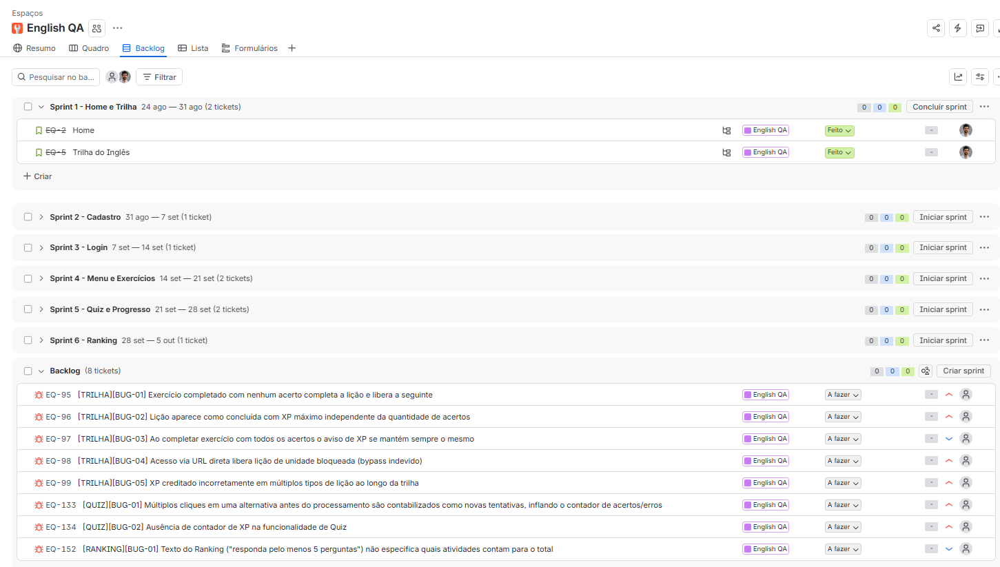

# 🧪 Testes Manuais — English QA

  

## 💻 Sobre o projeto
Trabalho voluntário de QA em parceria com a QAzando: testes manuais de ponta a ponta no
[English QA](https://english.qazando.com.br/), plataforma de inglês para profissionais de QA.

## 📊 Resultados
| Suítes | Casos de teste | Passou | Falhou | Bugs reportados |
|--------|----------------|--------|--------|-----------------|
|    9   |       121      |   116  |    5   | 8 (6 de severidade alta) |

Suítes: Home, Cadastro, Login, Menu Lateral, Trilha do Inglês, Exercícios, Quiz, Meu Progresso e Ranking.

## 🔄 Processo (aplicado a cada suíte)
1. **Plano de teste:** objetivo, escopo de teste, itens fora do escopo, ambiente e critérios de aceite
2. **Casos de teste:** pré-condição, passos para execução, resultado esperado, gherkin e prioridade
3. **Execução e reporte de bugs:** ambiente de execução, pré-requisitos, passos para reprodução, resultado esperado, resultado obtido, evidência , severidade e prioridade
4. **Gestão no Jira:** sprints por suítes



## 🐞 Bugs de destaque
| ID | Título | Severidade |
|---|---|---|
| [TRILHA][BUG-01] | Exercício completado com nenhum acerto completa a lição e libera a seguinte | Alta |
| [TRILHA][BUG-02] | Lição aparece como concluída com XP máximo independente da quantidade de acertos | Alta |
| [QUIZ][BUG-02] | Ausência de contador de XP na funcionalidade de Quiz | Alta |


## 📁 Estrutura do repositório
```text
testes-manuais-english-qa/
├── README.md
├── planos-de-teste/
│   ├── 01-home.pdf
│   ├── 02-cadastro.pdf
│   └── ... (9 PDFs, um por suíte)
├── casos-de-teste/
│   └── casos-de-teste-english-qa.xlsx
├── relatorio-de-bugs/
│   └── bug-report-english-qa.xlsx
└── evidencias/
```

## 👤 Autor
**Matheus Koehler Zanella** — Analista de QA · [LinkedIn](https://www.linkedin.com/in/matheus-koehler-zanella/)
